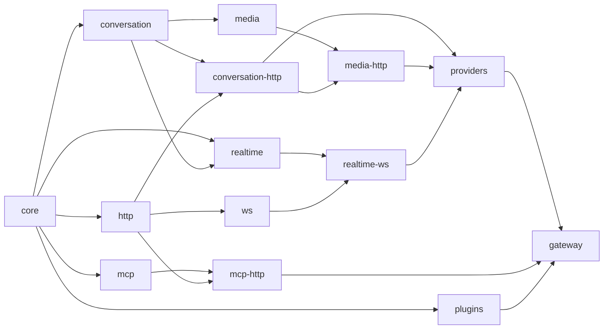

# Architecture

The gateway consists of reusable Rust libraries, a standalone application,
and runnable examples. The Python distribution (a PyO3 extension over the application library) lives in
[`python/`](../python/README.md).

## Repository layers

Libraries are in layers, each in its own folder, beside the kernel they
extend (`crates/core/`) and the first-party plugins (`crates/plugins/`):

```
            core
           /    \
      kinds      wires
           \    /
          formats
             |
         providers
             |
   plugins · apps/gateway · python · examples · validation
```

- A **kind** (`crates/kinds/`) owns a pair of events (`Input` in, `Output`
  out) that plugins read, and nothing else: its types, with no I/O, so a
  plugin depends on them alone.
- A **wire** (`crates/wires/`) moves bytes at both edges and knows no kind: its owned I/O
  types (`ClientIo`, `ProviderIo`), framing, credentials, a **transport** for
  the provider edge and **hosting** for the client edge (behind features).
- A **format** (`crates/formats/`) is a kind over a wire, a crate per pair
  (`conversation-http`, `media-http`, `realtime-ws`, `mcp-http`), each a
  `Format`. A format is a spec and names no vendor: what a provider sends
  beyond the spec stays native to it, where it appeared. It picks the wire
  capabilities its spec uses, such as a subprotocol or binary frames.
- The **providers** crate (`crates/providers/`) is every vendor, a file
  each: where it is, its key, its models, the formats it speaks, and its
  quirks, each described. A quirk, a deployment's departure from a spec, is
  data (such as a key header) or the vendor's plugin, which turns what it
  sends beyond the spec into the kind's events and back.

| Location | Sort | Owns | Internal production dependencies |
| --- | --- | --- | --- |
| `crates/core/` | Kernel | Execution, typed streams, plugin hooks, call and response lifecycles, fault facts and tagged native values | None |
| `crates/kinds/conversation/` | Kind | Conversation requests, reply events, typed usage and assembly | Core |
| `crates/kinds/media/` | Kind | A kind per media operation (images, transcription, speech, embeddings, video jobs) over the conversation kind's media and usage | Core, conversation |
| `crates/kinds/realtime/` | Kind | A live session's events both ways: configuration, audio, messages, responses, barge-in and tool calls, over the conversation kind's messages, tools and usage | Core, conversation |
| `crates/kinds/mcp/` | Kind | Typed JSON-RPC messages and their envelopes | Core |
| `crates/wires/http/` | Wire | HTTP bindings, framing, bodies, credentials, the opaque format; optional Reqwest transport and Axum hosting | Core |
| `crates/wires/ws/` | Wire | WebSocket sessions at both edges (provider transport, client `serve`); optional Axum hosting | Core, HTTP |
| `crates/formats/conversation-http/` | Format | The HTTP binding (`Schema`), OpenAI Chat and Anthropic Messages | Conversation, HTTP |
| `crates/formats/media-http/` | Format | OpenAI's media endpoints as compatible vendors serve them, and Veo's as a provider | Media, conversation-http, HTTP |
| `crates/formats/realtime-ws/` | Format | OpenAI Realtime, Gemini Live, and Responses over WebSocket, sharing their session's handshake | Realtime, HTTP, WS |
| `crates/formats/mcp-http/` | Format | Streamable HTTP and the stdio transport | MCP, HTTP |
| `crates/providers/` | Providers | Every vendor, a file each, and their quirks: data and plugins | Core, the formats |
| `crates/plugins/` | Plugins | The router (`Routes`, `Routing`), attempts, fallback, races and backoff | Core |
| `apps/gateway/` | Binary and library | Executable and the `respan_gateway` library it is built on: configuration (YAML, vendor presets, zero-config from the environment), composition (one core provider per format of a configured provider), routes from config, video job follow-ups, client keys, the request log, `/v1/models`, and the embedded web UI (`apps/ui/dist`) with its admin API | All of the above |
| `python/` | Python package | PyO3 extension hosting the `apps/gateway` library in-process, plus httpx transports and SDK clients | `apps/gateway` |
| `examples/` | Examples | Application policies and runnable integrations of public APIs | Libraries needed by each example |

Arrows below point from a dependency toward its consumers. Test dependencies
can cross these boundaries to exercise a complete request.



The workspace manifest centralizes local dependency paths and common package
settings. Crate names and `cargo run -p respan-gateway` remain independent of
their filesystem locations.

The application (`apps/gateway`) composes these crates with public APIs only.
A configured provider may speak several formats (a vendor preset speaks every
format of its vendor, as `crates/providers` says); the application registers one core
provider per format, runs each vendor's plugin on its providers' calls alone,
registered last so every other plugin sees the kind's events, and routes
with the plugins crate's router (see [Routing](#routing)). Each media operation
(`image`, `transcription`, `speech`, `embedding`, `video`) is a kind that translates
within itself. A video job's follow-up names no model, so a second plugin
sends it to the provider that made the job, by its id's spelling (`video_`,
`veo_`); providers sharing a spelling get ids wrapped in their name on the
way out, `<provider>~<id>`, unwrapped on the way in. The media crate's
`LocateContent` then finds a Veo job's content. Its HTTP application puts
`/healthz`, `/v1/models` and the web UI's admin API before the formats, and
client keys and the request log around them. Hosts reuse it as the
`respan_gateway` library: `App::new(config)` gives an `axum::Router`.

## Routing

Core does no routing: it knows provider names, and each request has a
target slot (`Gateway::target` for the default, `ClientContext::set_target`
per request). Routing is a plugin, `Routing` in `crates/plugins`, which
targets a request by `Routes`. Each kind's `Input` owns its model
(`model()`, `set_model()`); the router is given, per format, its `Kind`
(a label, and whether its formats translate) and a `Model` built from those
methods.

A configured provider is one core provider per format it speaks (`openai`,
`openai:openai-realtime`, ...), each added to `Routes` as what it `Speaks`.
Of the providers serving the request's kind, the router picks:

1. `provider/model` with `provider` configured, sending `model` alone;
2. else the `models` tables, the last defined first;
3. else the longest claimed prefix (the binary claims each vendor's
   prefixes from `crates/providers`);
4. else the kind's default: the target if it serves the kind, else the
   first provider that does.

It then targets that provider's core provider of the client's own format,
else, for a kind that translates, its first of the kind. A request of a
format the router was not given keeps its target.

## Design constraints

- The core owns execution and lifecycle contracts. It has no HTTP, provider,
  credential or LLM message dependency.
- Plugin authors use core directly. It supplies kind-neutral fault facts and
  native values; usage is typed by the kind that reports it.
  Protocol implementations depend on core; core does not depend on them.
- Plugins are compiled in. Applications register concrete components using
  the same public contracts available to external plugin authors.
- Wire crates own framing and transport behavior and know no kind. A kind's
  formats translate through its typed events, and name no vendor; vendors
  and their quirks are the providers crate's.
- Every kind is an `Input` in and an `Output` out, in the crate that owns
  it: `conversation`, `media` (a module per operation), `realtime`, and `mcp` (envelopes around its typed
  JSON-RPC `Message`). HTTP's passthrough (`formats::opaque`,
  `Input<F>` / `Output<F>`) is the one kind that is its own wire.
  Core defines no kinds or `Format` implementations.
  Plugins and whole-body conversation encoders share the conversation crate's ordered
  `Assembled` fold instead of maintaining separate reply representations.
- Applications own policy choices, configuration, prices, billing stores and
  durable jobs. The examples demonstrate those choices without making them
  supported public APIs.
- Core contracts are stable by default. Changes to those contracts require
  corresponding documentation and behavioral tests.

## One shape at both edges

`Format<T, R, W>` binds an owned transport to a receive future and an outgoing
event sink. The gateway assigns the edge's role: a client binding receives
inputs and sends outputs; a provider binding receives outputs and sends inputs.
The core drives typed streams and sinks while protocol code owns bytes and heads.

`Plugin` provides client and provider hooks, including an end hook for each
lifecycle. Filters edit typed events; calls let plugins invoke providers using
the client's input or input of their own. Responses can be streamed, inspected
or buffered. HTTP raw relay behavior is an explicit policy in the HTTP crate.

An HTTP format binds `ClientIo` and `ProviderIo` with mirrored `bind`s, each
given what only the protocol knows: a decoder, an encoder, and an error
writer or reader. The bindings own what every HTTP format shares, so no
format can forget it: response handoff and backpressure, whole or live
uploads, the headers no proxy passes on, a fault's status and `Retry-After`,
refused answers read whole into a fault, and no body where HTTP has none.

See the [core guide](../crates/core/README.md),
[conversation guide](../crates/kinds/conversation/README.md),
[conversation formats guide](../crates/formats/conversation-http/README.md),
[providers guide](../crates/providers/README.md),
[HTTP guide](../crates/wires/http/README.md), and
[routing guide](../crates/plugins/README.md) for their public contracts.

## Tests and examples

Unit tests remain beside private implementation details. Integration suites
live in the owning crate's `tests/` directory; larger suites use topic modules.
Shared source-only fixtures live in [`tests/support/`](../tests/support/README.md).
The gateway application owns tests that start its executable.

Examples retain their topic directories. Their included test modules live in
`examples/tests/cases/<topic>/`, and standalone text regression suites live in
`examples/tests/text_*.rs`. Private example implementations and helpers live
under `examples/support/`; shared example library APIs live under `examples/src/`.

The independent `validation/` Cargo package is excluded from the workspace. It
owns live-provider and external-tool checks; all workspace tests run locally.

See [testing](TESTING.md) for commands and external requirements.
