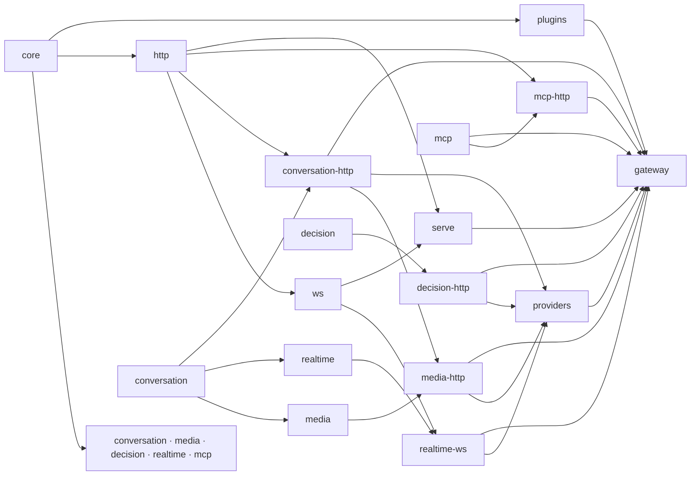

# Architecture

The gateway consists of reusable Rust libraries, a standalone application,
and runnable examples. The Python distribution (a PyO3 extension over the application library) lives in
[`python/`](../python/README.md).

## Repository layers

Libraries are in layers, each in its own folder, beside the kernel they
extend (`crates/core/`) and the first-party plugins (`crates/plugins/`):

```
            core
           /    \
      kinds      wires
           \    /
          formats
             |
         providers
             |
   plugins · serve · apps/gateway · python · examples · validation
```

- A **kind** (`crates/kinds/`) owns a pair of events (`Input` in, `Output`
  out) that plugins read, and nothing else: its types, with no I/O, so a
  plugin depends on them alone.
- A **wire** (`crates/wires/`) moves bytes at both edges and knows no kind: its owned I/O
  types (`ClientIo`, `ProviderIo`), framing, credentials, and a **transport**
  for the provider edge (behind a feature).
- The **serve** crate (`crates/serve/`) is hosting, beside the plugins and
  providers: it serves a `Gateway` over Axum, plain HTTP and WebSocket
  upgrades from one router, so no wire hosts anything.
- A **format** (`crates/formats/`) is a kind over a wire, a crate per pair
  (`conversation-http`, `media-http`, `decision-http`, `realtime-ws`, `mcp-http`, and `passthrough-http`, whose kind is its own), each a
  `Format`. A format is a spec and names no vendor: what a provider sends
  beyond the spec stays native to it, where it appeared. It picks the wire
  capabilities its spec uses, such as a subprotocol or binary frames.
- The **vendor kit** crate (`crates/vendors/kit/`) is a vendor as a template, and
  a provider of one at a base URL with a key, which registers a core
  provider of each of its formats and lists its models, and what vendors
  share. The **vendors** crate (`crates/vendors/`) is every vendor, a file
  each in its tier's crate: green (`crates/vendors/green/`), verified end to
  end against its live API, or yellow (`crates/vendors/yellow/`), tested
  against fakes alone. A vendor says where it is, its key, and the formats
  it speaks. A quirk, a deployment's departure from a
  spec, is data (such as a key header) or in a format it speaks: its
  dialect of the spec (`conversation-http`'s `dialect`), which turns what it
  sends beyond the spec into the kind's events and back inside the format,
  or a format of its own. What a spec's own vendor does is the spec's
  format's.

| Location | Sort | Owns | Internal production dependencies |
| --- | --- | --- | --- |
| `crates/core/` | Kernel | Execution, typed streams, plugin hooks, call and response lifecycles, fault extensions and tagged native values | None |
| `crates/sdk/` | Vocabulary | A model's card (`Model`), its `Price`, the shared `Catalog`, and who a request is for (`Caller`) | None (a leaf) |
| `crates/kinds/conversation/` | Kind | Conversation requests, reply events, typed usage and assembly | Core |
| `crates/kinds/media/` | Kind | A kind per media operation (images, transcription, speech, embeddings, video jobs) over the conversation kind's media and usage | Core, conversation |
| `crates/kinds/decision/` | Kind | Typed questions about a state (yes-or-no, choice, score), each answered with probabilities | Core, conversation (usage) |
| `crates/kinds/realtime/` | Kind | A live session's events both ways: configuration, audio, messages, responses, barge-in and tool calls, over the conversation kind's messages, tools and usage | Core, conversation |
| `crates/kinds/mcp/` | Kind | Typed JSON-RPC messages and their envelopes | Core |
| `crates/wires/http/` | Wire | HTTP bindings, framing, bodies, credentials, path matching and forwarding, the raw request and answer, what a transport does to a call, and how a provider format is reached (`Upstream`) | Core, HTTP faults, SSE |
| `crates/wires/http-faults/` | Wire | Faults in HTTP terms, with no I/O: a fault's status and error code, retry eligibility, a provider's error answer as a fault | Core |
| `crates/wires/sse/` | Wire | Server-sent events as bytes: an incremental splitter, and events written so no value forges a field | Core |
| `crates/wires/http-transport/` | Wire | `HttpTransport`, a pooled Reqwest backend for the provider edge | Core, HTTP |
| `crates/wires/ws/` | Wire | WebSocket sessions at both edges (provider transport, client `serve`) | Core, HTTP |
| `crates/formats/conversation-http/` | Format | The HTTP binding (`Schema`) and four chat formats: OpenAI Chat, Anthropic Messages, Gemini `generateContent` and OpenAI Responses; reasoning controls map between them | Conversation, HTTP |
| `crates/formats/media-http/` | Format | OpenAI's media endpoints as compatible vendors serve them, and Veo's | Media, conversation-http, HTTP |
| `crates/formats/decision-http/` | Format | TypeSafe's System One | Decision, conversation-http, HTTP |
| `crates/formats/realtime-ws/` | Format | OpenAI Realtime and Gemini Live, translated both ways (audio converted, the other's scaffolding emulated), and Responses over WebSocket, sharing their session's handshake | Realtime, HTTP, WS |
| `crates/formats/mcp-http/` | Format | Streamable HTTP and the stdio transport | MCP, HTTP |
| `crates/formats/passthrough-http/` | Format | `Input<F>` / `Output<F>`, HTTP traffic of no kind relayed unread, and the `Passthrough` format | HTTP |
| `crates/vendors/kit/` | Vendors | A vendor as a template (`Vendor`), and a provider of it (`VendorProvider`): each format (any core `Format` that says how its spec has it reached, `Upstream`) at its base URL with its key, registered; its model list and a client of it; what vendors share (every spec's format, `FORMATS`; Chat Completions' dialect helpers, `chat`) | Core, HTTP, HTTP faults, HTTP transport, WS, the formats, the conversation kind |
| `crates/vendors/green/` | Vendors | The green vendors (OpenAI, Anthropic, Gemini, TypeSafe), a file each, and their quirks: verified end to end by the validation package's live tests | The vendor kit, core, the formats, the conversation kind |
| `crates/vendors/yellow/` | Vendors | The yellow vendors, a file each, and their quirks (such as Groq's usage, DeepSeek's `reasoning_content`): tested against fakes, not end to end | The vendor kit, core, the formats, the conversation kind |
| `crates/vendors/` | Vendors | Every vendor, by name (`ALL`, `GREEN`, `YELLOW`, `find`) | The vendor kit, the green and yellow vendors |
| `crates/serve/` | Hosting | One Axum router for a gateway: plain HTTP and WebSocket upgrades, body and session limits, graceful stop | Core, HTTP, WS |
| `crates/plugins/*` | Plugins, one crate each | `routing` (`Routes`, `Rule`, `Routing`, and `Dispatch`, which sends a request to a rule's candidates), `fallback` (`Fallback`, `Hedge`, and the attempt, race and backoff helpers `Dispatch` is built on) and `tool-loop` (`ToolLoop`, and the `ToolFilter` and `ToolScope` that say which tools are offered) | Core and the conversation kind |
| `crates/plugins/respan/` | Plugin | `Respan`: each request a trace sent to Respan over OTLP, a span per call to a model or tool server, posted in batches off the request path | Core, the conversation kind, HTTP transport |
| `crates/plugins/relay/` | Plugin | `Relay`: a client's request, key, response head and error body forwarded as they came, to a provider of its own format | Core, HTTP |
| `crates/plugins/credentials/` | Plugin | `ClientCredentials`: a client's own key headers to the named providers that have no key of their own, of the client's format | Core, HTTP |
| `crates/plugins/mcp-aggregate/` | Plugin | `Aggregate`: one MCP endpoint, `/mcp`, fronting many MCP servers as a single server | Core, HTTP, MCP, mcp-http, tool loop (`ToolFilter`, `ToolScope`) |
| `apps/gateway/` | Binary and library | Executable and the `respan_gateway` library it is built on: configuration (TOML, vendors, zero-config from the environment), composition (one core provider per format of a configured provider), routes from config, video job follow-ups, client keys, the request log, `/v1/models`, and the embedded web UI (`apps/ui/dist`) with its admin API | The kinds, wires, formats, providers and plugins above, and MCP (`mcp:` servers at `/mcp/{name}`) |
| `apps/ui/` | Web UI | React and shadcn/ui admin UI (providers, routes, live requests), built by `pnpm build` to `apps/ui/dist` and embedded in the binary by `apps/gateway/build.rs`; a placeholder page stands in when it is not built | None (talks to the admin API) |
| `python/` | Python package | PyO3 extension hosting the `apps/gateway` library in-process, plus httpx transports and SDK clients | `apps/gateway` |
| `examples/` | Examples | Application policies and runnable integrations of public APIs | Libraries needed by each example |

Arrows below point from a dependency toward its consumers. Test dependencies
can cross these boundaries to exercise a complete request.



Core is a dependency of every crate, and `conversation` also of
`conversation-http`, `media-http`, `realtime-ws` and `providers`; those
edges are left out above.

The workspace manifest centralizes local dependency paths and common package
settings. Crate names and `cargo run -p respan-gateway` remain independent of
their filesystem locations.

The application (`apps/gateway`) composes these crates with public APIs only.
A configured provider may speak several formats (a vendor's speaks every
format of its vendor, as `crates/vendors` says); the application registers one core
provider per format, runs each vendor's plugin on its providers' calls alone,
registered last so every other plugin sees the kind's events, and routes
with the plugins crate's router (see [Routing](#routing)). Each media operation
(`image`, `transcription`, `speech`, `embedding`, `video`) is a kind that translates
within itself, and so is `realtime`; Responses over WebSocket is a routing
kind of its own, `responses`, which does not. A video job's follow-up names no model, so a second plugin
sends it to the provider that made the job, by its id's spelling (`video_`,
`veo_`); providers sharing a spelling get ids wrapped in their name on the
way out, `<provider>~<id>`, unwrapped on the way in. The media crate's
`LocateContent` then finds a Veo job's content. Its HTTP application puts
`/healthz`, `/v1/models` and the web UI's admin API before the formats, and
client keys and the request log around them. Hosts reuse it as the
`respan_gateway` library: `App::new(config)` gives an `axum::Router`.

## Kinds and routing vocabulary

A **kind** is a pair of event types; the router labels each format with the
kind it routes within. `chat` is the conversation kind (all four chat
formats translate within it); `image`, `transcription`, `speech`,
`embedding` and `video` are the media kinds; `realtime` is the realtime
kind; `responses` is Responses over WebSocket, a routing kind of its own
that relays and does not translate.

## Routing

Core does no routing: it knows provider names, and each request has a
target slot (`Gateway::target` for the default, `ClientContext::set_target`
per request). Routing is a plugin, `Routing` in `crates/plugins/routing`, which
targets a request by `Routes`. Each kind's `Input` owns its model
(`model()`, `set_model()`); the router is given, per format, its `Kind`
(a label, and whether its formats translate) and a `Model` built from those
methods (`Model::of`), or from any read and write (`Model::new`): a
realtime session is routed before its first input, so its model is read
from its handshake's `?model=`.

A configured provider is one core provider per format it speaks (`openai`,
`openai:openai-realtime`, ...), each added to `Routes` as what it `Speaks`.
Of the providers serving the request's kind, the router picks:

1. the candidates of a `Rule` named exactly the model;
2. else `provider/model` with `provider` configured, sending `model` alone;
3. else the candidates of the first glob `Rule` (`llama-*`) that matches,
   in the order added;
4. else the provider whose model listing names it (`Catalog::lists`, read
   from the listings the binary fetches at start and every ten minutes
   unless `plugins.routing.listings = false`); of several, the one that
   claims the name, else the first configured;
5. else the longest claimed prefix (the binary claims each vendor's
   usual model names, `vendors::claims`), for aliases and unlisted models;
6. else the kind's default: the target if it serves the kind, else the
   first provider that does.

A rule none of whose candidates serve the kind, or whose clients or kinds
exclude the request, is skipped. A rule orders its `Candidate`s by its
`Pick` (as listed, cheapest, fastest, by weight or at random), from what the
providers' listings say (`Catalog`, `Facts`: price and capabilities, for
`needs`) and what the router saw of its own calls (`Stats`: a latency moving
average and error rate per candidate, recorded in `on_provider_end`); one
that failed its last 3 calls within 30 s goes last. `Routes::plan` gives the
`Planned` candidates (each a `Chosen`), why (`By`) and those passed over.

It then targets the first candidate's core provider of the client's own
format, else, for a kind that translates, its first of the kind, and sends
it its model. `Dispatch`, registered last, sends a rule-routed request to its
candidates as the rule says: in turn with retries (`first_success`), or raced
(`race`, its `hedge`). A request of a format the router was not given keeps
its target.

## Design constraints

- The core owns execution and lifecycle contracts. It has no HTTP, provider,
  credential or LLM message dependency.
- Plugin authors use core directly. It supplies kind-neutral fault extensions and
  native values; usage is typed by the kind that reports it.
  Protocol implementations depend on core; core does not depend on them.
- Plugins are compiled in. Applications register concrete components using
  the same public contracts available to external plugin authors.
- Wire crates own framing and transport behavior and know no kind. A kind's
  formats translate through its typed events, and name no vendor; vendors
  and their quirks are the providers crate's.
- Every kind is an `Input` in and an `Output` out, in the crate that owns
  it: `conversation`, `media` (a module per operation), `realtime`, and `mcp` (envelopes around its typed
  JSON-RPC `Message`). The passthrough format (`passthrough-http`,
  `Input<F>` / `Output<F>`) is the one kind that lives in its format's crate.
  Core defines no kinds or `Format` implementations.
  Plugins and whole-body conversation encoders share the conversation crate's ordered
  `Assembled` fold instead of maintaining separate reply representations.
- MCP sessions belong to the client that opened them. After the client key
  checks out, the binary puts an `Owner` (a keyed hash of the key, never the
  key) in the call's extensions. `StdioTransport` keys its sessions by it; for
  an HTTP server the binary remembers which owner each `Mcp-Session-Id` was
  given to and answers another owner 404, as for an unknown session. Without
  client keys there is no owner and one caller class. `check --online` probes
  each server with an `initialize` (HTTP: then `DELETE`; stdio: spawn, stop).
- Applications own policy choices, configuration, prices, billing stores and
  durable jobs. The examples demonstrate those choices without making them
  supported public APIs.
- Core contracts are stable by default. Changes to those contracts require
  corresponding documentation and behavioral tests.

## One shape at both edges

`Format<T, R, W>` binds an owned transport to a receive future and an outgoing
event sink. The gateway assigns the edge's role: a client binding receives
inputs and sends outputs; a provider binding receives outputs and sends inputs.
The core drives typed streams and sinks while protocol code owns bytes and heads.

`Plugin` provides client and provider hooks, including an end hook for each
lifecycle. Filters edit typed events; calls let plugins invoke providers using
the client's input or input of their own. Responses can be streamed, inspected
or buffered. A request is always written again by its provider's format;
response heads and error bodies relay as they came only by explicit policy
(`Relay`, which marks a call to a provider of its client's own format
`Relayed`).

An HTTP format binds `ClientIo` and `ProviderIo` with mirrored `bind`s, each
given what only the protocol knows: a decoder, an encoder, and an error
writer or reader. The bindings own what every HTTP format shares, so no
format can forget it: response handoff and backpressure, whole or live
uploads, the headers no proxy passes on, a fault's status and `Retry-After`,
refused answers read whole into a fault, and no body where HTTP has none.

See the [core guide](../crates/core/README.md),
[conversation guide](../crates/kinds/conversation/README.md),
[conversation formats guide](../crates/formats/conversation-http/README.md),
[vendors guide](../crates/vendors/README.md),
[HTTP guide](../crates/wires/http/README.md), and
[plugins guide](../crates/plugins/README.md) for their public contracts.

## Tests and examples

Unit tests remain beside private implementation details. Integration suites
live in the owning crate's `tests/` directory; larger suites use topic modules.
Shared source-only test helpers live in [`tests/support/`](../tests/support/README.md).
The gateway application owns tests that start its executable.

Examples retain their topic directories. Their included test modules live in
`examples/tests/cases/<topic>/`, and standalone text regression suites live in
`examples/tests/text_*.rs`. Private example implementations and helpers live
under `examples/support/`; shared example library APIs live under `examples/src/`.

The independent `validation/` Cargo package is excluded from the workspace. It
owns live-provider and external-tool checks; all workspace tests run locally.

See [testing](TESTING.md) for commands and external requirements.

## Glossary

A client sends a request, plugins look at it, the gateway sends it on to a
provider, and the response streams back through the plugins. The kernel
routes events and never sees a byte, a head or a key: the client edge and
the provider edge own them (see [One shape at both edges](#one-shape-at-both-edges)).

- **Gateway**: what you build and hand requests to: providers, client
  formats, plugins and a default target, each registered by value.
- **Plugin**: four hooks, `on_client` and `on_client_end` once per
  request, `on_provider` and `on_provider_end` once per call, in
  registration order. `on_client` passes (`Ok(None)`), replies or refuses.
- **Provider**: a name, the format it speaks, how each call gets a
  transport, and its own plugins (`Provider::new(..).plugin(..)`, added with
  `Gateway::provider`). A provider's own plugins' `on_provider` and
  `on_provider_end` run on its calls alone, after the gateway's plugins.
- **Filter**: edits a request's inputs or a response's outputs as they
  stream; its type says which. For work that waits, such as a remote check
  or a deadline, a plugin wraps the stream in its own (`cx.wrap`).
- **Format<T, R, W>**: one protocol's binding to owned I/O `T`, receiving
  `R` and sending `W`. Its `bind(io)` returns a `Connection<R, W>`: an
  incoming opening future and an outgoing `EventSink<W>`. An optional
  synchronous preparation step configures the sink from the stream's shape
  or a finite input before delivery. The kernel pumps events with
  backpressure, then closes the sink. Formats of one kind translate through
  typed events; calls always encode typed input unless an application
  explicitly supplies raw HTTP data. HTTP formats implement the same
  contract directly, with mirrored `bind`s that each take a decoder, an
  encoder and an error writer (client) or reader (provider).
- **Call**: what the gateway sends a provider on a request's behalf
  (`cx.call`): the request's inputs as filters left them, or one input of
  its own (`with_input`). A request is always written again by its
  provider's format; to a provider of the client's own format it carries
  the client's spec headers and query parameters. A call marked `Relayed`
  gives the client its provider's head, error body and close code, and the
  provider its client's key; a plugin opts into a raw error with `RawReply`
  too. Credentials are otherwise separate and must be copied explicitly.
  The binary copies a client's credentials to a keyless provider of the
  client's own format, which its `proxy` mode relies on.
- **Response**: what a call, or `Response::stream`, gives back: read
  (`outputs`), held (`buffer_until`, `until_end`) or sent. Buffered events,
  errors and call ownership remain available for replay even when
  inspection fails.
- **Fault**: the one error: a code that says whose fault it is, a message,
  a retry and typed hints such as HTTP's `Status`.

HTTP formats prepare requests and event sinks synchronously, then let core
drive delivery; an `Encoder<T>` writes values and terminal framing and does
not choose heads, open responses or act as a transport. Core exposes
contracts and shared types, not production `Plugin` implementations, and
depends on no protocol, provider, plugin or adapter. Billing policies and
priced tallies live in private
[example support](../examples/README.md#billing-policies); the conversation
kind's typed `Usage` is the shared fact, and applications own prices,
accounts and stores.

## Reload and admin writes

The config is reloaded from its source (SIGHUP, `POST /ui/api/reload`,
`--watch`) by building a new gateway and swapping it in for new requests,
the old one finishing its open ones. `GET /ui/api/config` shows a read-only
view with every secret redacted.

## MCP in the binary

`mcp:` servers are not `providers:`: a server is an MCP upstream, a streamable
HTTP `url` or a stdio `command`, and they share no formats with the chat
providers. `apps/gateway/src/mcp.rs` composes them as one format, `mcp`
(kind `mcp`, which does not translate), whose clients are served at
`/mcp/{name}` for the configured names only (`StreamableHttp::serving`) and
whose servers are core providers named by their `mcp:` key, each with its own
`StreamableHttp` toward it (HTTP upstream path as configured, its `headers` and `auth` as headers)
or its own `StdioTransport` (one child per client session, limits at the
transport's defaults but 32 sessions). `Routing` does not route the kind; a
small plugin, `McpRoute`, targets the server named by the request path, so a
client cannot choose another's. Credentials follow the provider rule: an
upstream key replaces the client's, and `ClientCredentials`
(`crates/plugins/credentials`) forwards a
client's only to a server with `auth = "forward"`. The request log shows the
method (and tool, prompt or resource) where other kinds show a model; the
server is the provider. Children are the transport's: process groups,
`stdin` closed then SIGTERM then SIGKILL, and `kill_on_drop` when the runtime
stops; on Windows the child starts in its own process group and ends with the
processes it started (`taskkill /T /F`). Admin views and `check` show a
server by its origin or program name only, never a path, argument or
environment.

### The aggregate endpoint

`plugins: mcp_aggregate` adds `/mcp` beside `/mcp/{name}` (`StreamableHttp::with_root`).
`Aggregate` (`crates/plugins/mcp-aggregate`; the binary's config and its check
are `apps/gateway/src/mcp_aggregate.rs`) is a plugin, registered before
`McpRoute`, that answers requests to the root itself with `Response::stream`,
as the tool loop does: it is an MCP server toward the client and the gateway's
client of each `mcp:` server toward the providers, through `ClientContext::call`
with the client's own extensions, so the `Owner` of the client key reaches the
upstream transports and each server's own credentials apply. State is one table
of client sessions (id, owner, and per server an optional upstream session
opened by `initialize` and reopened once if a call on it fails); upstream
sessions are not recoverable after the client's request ends, so they end with
the client's `DELETE` and otherwise with the servers' own idle timeouts.
Nothing is looked up to route: tools and prompts are `{server}__{name}` (the
longest server name that prefixes the name wins), resources are
`mcp://{server}/{uri}`, and a list cursor is a JSON object of the upstream
cursors of the servers with more. A routed call streams the server's answer
(progress notifications included) with URIs in its result prefixed; the `GET`
stream merges the servers' own, keeping list changes, resource updates and log
messages. The request log shows one entry per client request.

### OAuth upstreams

`apps/gateway/src/mcp_oauth.rs` is a token source per HTTP server with
`oauth:` (client credentials, or refresh token if one is set; one task at a
time fetches, the token is cached to its expiry less 30 seconds). It sits in
`SessionOwners::send`, the wrapper every HTTP server's calls already pass for
the session-owner check: the call gets `Authorization: Bearer`, and a `401`
drops that token, gets another and sends a call with a whole body once more.
`check --online` takes a token for its probe. Secrets are read at load through
the same `env:` rule as keys and have no `Debug` output.

## The binary's plugins

The binary configures each compiled-in plugin under its own name in
`plugins:` (`PluginsConfig`), and registers them in an order of its own,
whatever the file's (`with_plugins` in `apps/gateway/src/app/built.rs`): the
closers of the tool loop's and the aggregate's sessions; the request log
(`request_log`); routing (`routing`); the MCP aggregate (`mcp_aggregate`) and
`/mcp/{name}` routing; video jobs (`VideoJobs` and `LocateContent`, of the
media kind); whose credentials go where; the tool loop
(`tool_loop`); then the dispatch of routes (`Dispatch`). Routing, dispatch,
the request log, MCP routing, video jobs and credentials are always on; the
tool loop and the aggregate only when configured.

A vendor's quirks are not plugins: they are in the formats its providers
speak, its dialect of a spec among them, so they are the provider edge's
innermost, every plugin sees the kind's events, and nothing turns them
off.

The order is what makes them compose. Plugins that target and edit a request
come before the ones that answer it themselves (the tool loop, dispatch),
and the first of those that applies answers it: a request the tool loop runs
is not sent to a route's other candidates.

Routes (the top-level `routes`) name configured providers;
`apps/gateway/src/rules.rs` turns each into a `Rule`, its `fallback`, `tries`,
`backoff`, `hedge` and `until` the rule's attempts, and refuses the retired
`plugins.routing.models`, `plugins.fallback` and `plugins.hedge` saying how
each is now written.

## The tool loop

The loop that runs tools inside a chat request is a plugin, not a kernel
feature: `ToolLoop` in `crates/plugins/tool-loop` depends on the core and the
conversation kind alone, so it serves every chat format and provider. In
`on_client`, after routing has chosen the target and the request is in scope,
it asks a `Tools` runner for the request's `Toolbox` (`list` and `call`),
adds the listed tools to the conversation and answers the request itself with
`Response::stream`: each step is a `Call` of the target with its own input
(`Call::with_input`, so translation, provider-edge filters and the provider's format apply
as for any call), read as `Output` events. A step's events flow to the client
(blocks renumbered without gaps over the steps), except the runner's tool
calls, usage and the finish, which are decided when the step ends: calls only to
the runner's tools are run (at most `parallel` at once, their answers sharing
a per-request byte budget) and appended to the conversation as
the assistant's calls and a user message of results; anything else ends the
loop, with the usage summed. Because the plugin replies, it is registered
after the plugins that route or edit the request.

Over a live session (the realtime kind) the plugin answers nothing: it wraps
the session's two directions. The inputs get the tools in each configuration
that sets tools, and are merged with what the loop sends: the answers of the
calls it runs, as they come (bounded by `parallel`), then a request to
respond once the calls of a response are answered and no response is being
made. The outputs lose those calls, every object of the format's own events
that names one of the loop's tools or carries one of its calls' ids, and a
response that said nothing else (its start is held until it says something,
and a format's own events after its end are dropped until the next starts).

The binary supplies the runner and the policy: `apps/gateway/src/tool_loop.rs`
implements `Tools` with MCP, as the gateway's own client of the `mcp:`
servers it already composes as providers. A tool call is a `Call` to the
server's provider with an MCP `Input` (the server's credentials are the
transport's; the call carries the `Owner` of no client key, and
`ToolHop` so the request log keeps the server out of the request's provider
field), through a session the runner keeps per server and restarts when lost,
and a per-server tool list with a TTL, filtered by `plugins.tool_loop.allow` and
`plugins.tool_loop.deny` (patterns over the name the model has). The config check refuses
servers with `auth = "forward"`. `check --online` asks the same runner, through a
request of the gateway's own marked with an extension no client can send, for
the tools it offers. The steps and tool calls go to the request log through the
plugin's observer (`ToolLoop::observe`), which the recorder's entry implements.
