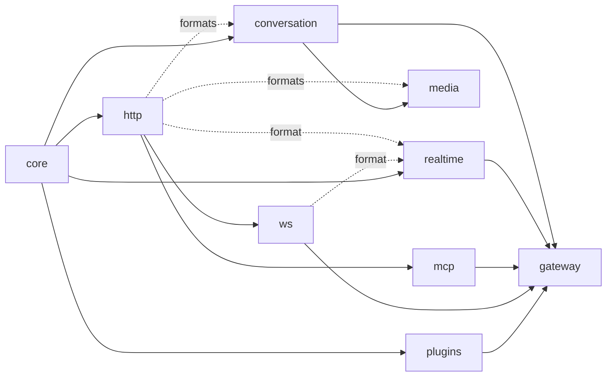

# Architecture

The gateway consists of reusable Rust libraries, a standalone application,
and runnable examples. The Python distribution (a PyO3 extension over the application library) lives in
[`python/`](../python/README.md).

## Repository layers

Libraries are of two sorts, each in its own folder, beside the kernel they
extend (`crates/core/`) and the first-party plugins (`crates/plugins/`):

- A **kind** (`crates/kinds/`) owns a pair of events (`Input` in, `Output` out) that plugins
  read, and everything about that kind on the wire: its formats, each a
  `Format`, and its vendors' dialects. A kind is tied to one wire
  (conversation and media to HTTP and SSE, realtime to WebSocket, MCP to
  streamable HTTP or stdio); what varies within it is the provider, and the kind's
  events are what every provider has in common. Its formats are behind
  default features, so a plugin can depend on its types alone.
- A **wire** (`crates/wires/`) moves bytes at both edges and knows no kind: its owned I/O
  types (`ClientIo`, `ProviderIo`), framing, credentials, a **transport** for
  the provider edge and **hosting** for the client edge (behind features).

| Location | Sort | Owns | Internal production dependencies |
| --- | --- | --- | --- |
| `crates/core/` | Kernel | Execution, typed streams, plugin hooks, call and response lifecycles, fault facts and tagged native values | None |
| `crates/kinds/conversation/` | Kind | Conversation requests, reply events, typed usage and assembly; the HTTP binding (`Schema`) and its vendors, OpenAI Chat (with dialects) and Anthropic Messages | Core; HTTP for its formats |
| `crates/kinds/media/` | Kind | A kind per media operation (images, transcription, speech) over the conversation kind's media and usage; their HTTP formats, OpenAI's endpoints as compatible vendors serve them | Core, conversation's types; HTTP for its formats |
| `crates/kinds/realtime/` | Kind | Format-tagged realtime event pair; the WebSocket format (`JsonEvents`) and its vendor presets | Core; HTTP, WS for its format |
| `crates/kinds/mcp/` | Kind | Typed JSON-RPC messages and their envelopes; streamable HTTP and the stdio transport | Core, HTTP |
| `crates/wires/http/` | Wire | HTTP bindings, framing, bodies, credentials, the opaque format; optional Reqwest transport and Axum hosting | Core |
| `crates/wires/ws/` | Wire | WebSocket sessions at both edges (provider transport, client `serve`); optional Axum hosting | Core, HTTP |
| `crates/plugins/` | Plugins | Model routing, attempts, fallback, races and backoff | Core |
| `apps/gateway/` | Binary and library | Executable and the `respan_gateway` library it is built on: configuration (YAML, vendor presets, zero-config from the environment), composition (one core provider per format of a configured provider), its routing step, client keys, the request log, `/v1/models`, and the embedded web UI (`apps/ui/dist`) with its admin API | All of the above |
| `python/` | Python package | PyO3 extension hosting the `apps/gateway` library in-process, plus httpx transports and SDK clients | `apps/gateway` |
| `examples/` | Examples | Application policies and runnable integrations of public APIs | Libraries needed by each example |

Arrows below point from a dependency toward its consumers. Test dependencies
can cross these boundaries to exercise a complete request.

The workspace manifest centralizes local dependency paths and common package
settings. Crate names and `cargo run -p respan-gateway` remain independent of
their filesystem locations.

The application (`apps/gateway`) composes these crates with public APIs only.
A configured provider may speak several formats (a vendor preset speaks every
format of its vendor compiled in); the application registers one core
provider per format and routes with one plugin of its own: `provider/model`,
then `models` routes, then preset model prefixes, then the kind's default,
among the providers serving the request's kind. Its HTTP application puts
`/healthz`, `/v1/models` and the web UI's admin API before the formats, and
client keys and the request log around them. Hosts reuse it as the
`respan_gateway` library: `App::new(config)` gives an `axum::Router`.

## Design constraints

- The core owns execution and lifecycle contracts. It has no HTTP, provider,
  credential or LLM message dependency.
- Plugin authors use core directly. It supplies kind-neutral fault facts and
  native values; usage is typed by the kind that reports it.
  Protocol implementations depend on core; core does not depend on them.
- Plugins are compiled in. Applications register concrete components using
  the same public contracts available to external plugin authors.
- Wire crates own framing and transport behavior and know no kind. A kind's
  vendor formats translate through its typed events.
- Every kind is an `Input` in and an `Output` out, in the crate that owns
  it: `conversation`, `media` (a module per operation), `realtime` and `mcp` (envelopes around its typed
  JSON-RPC `Message`). HTTP's passthrough (`formats::opaque`,
  `Input<F>` / `Output<F>`) is the one kind that is its own wire.
  Core defines no kinds or `Format` implementations.
  Plugins and whole-body conversation encoders share the conversation crate's ordered
  `Assembled` fold instead of maintaining separate reply representations.
- Applications own policy choices, configuration, prices, billing stores and
  durable jobs. The examples demonstrate those choices without making them
  supported public APIs.
- Core contracts are stable by default. Changes to those contracts require
  corresponding documentation and behavioral tests.

## One shape at both edges

`Format<T, R, W>` binds an owned transport to a receive future and an outgoing
event sink. The gateway assigns the edge's role: a client binding receives
inputs and sends outputs; a provider binding receives outputs and sends inputs.
The core drives typed streams and sinks while protocol code owns bytes and heads.

`Plugin` provides client and provider hooks, including an end hook for each
lifecycle. Filters edit typed events; calls let plugins invoke providers using
the client's input or input of their own. Responses can be streamed, inspected
or buffered. HTTP raw relay behavior is an explicit policy in the HTTP crate.

An HTTP format binds `ClientIo` and `ProviderIo` with mirrored `bind`s, each
given what only the protocol knows: a decoder, an encoder, and an error
writer or reader. The bindings own what every HTTP format shares, so no
format can forget it: response handoff and backpressure, whole or live
uploads, the headers no proxy passes on, a fault's status and `Retry-After`,
refused answers read whole into a fault, and no body where HTTP has none.

See the [core guide](../crates/core/README.md),
[conversation guide](../crates/kinds/conversation/README.md),
[HTTP guide](../crates/wires/http/README.md), and
[routing guide](../crates/plugins/README.md) for their public contracts.

## Tests and examples

Unit tests remain beside private implementation details. Integration suites
live in the owning crate's `tests/` directory; larger suites use topic modules.
Shared source-only fixtures live in [`tests/support/`](../tests/support/README.md).
The gateway application owns tests that start its executable.

Examples retain their topic directories. Their included test modules live in
`examples/tests/cases/<topic>/`, and standalone text regression suites live in
`examples/tests/text_*.rs`. Private example implementations and helpers live
under `examples/support/`; shared example library APIs live under `examples/src/`.

The independent `validation/` Cargo package is excluded from the workspace. It
owns live-provider and external-tool checks; all workspace tests run locally.

See [testing](TESTING.md) for commands and external requirements.
