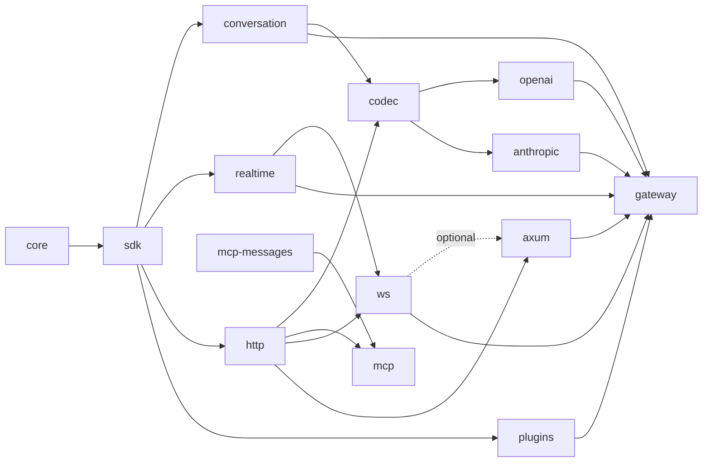

# Architecture

The gateway consists of reusable Rust libraries, a standalone application,
and runnable examples. The Python distribution is planned separately under
[`python/`](../python/README.md).

## Repository layers

| Location | Owns | Internal production dependencies |
| --- | --- | --- |
| `crates/core/` | Execution, typed streams, plugin hooks, call and response lifecycles | None |
| `crates/sdk/` | Public core facade, usage, fault facts and tagged native values | Core |
| `crates/conversation/` | Conversation requests, reply events and assembly | SDK |
| `crates/realtime/` | Format-tagged realtime event pair | SDK |
| `crates/mcp-messages/` | Typed JSON-RPC messages | None |
| `crates/http/` | HTTP bindings, framing, bodies, credentials and optional Reqwest transport | SDK |
| `crates/ws/` | WebSocket sessions at both edges (provider transport, client `serve`), JSON event format and its vendor presets | SDK, realtime, HTTP |
| `crates/mcp/` | MCP streamable HTTP and stdio transport | SDK, mcp-messages, HTTP |
| `crates/codec/` | What the conversation codecs share: HTTP codec, reader and encoder machinery | SDK, conversation, HTTP |
| `crates/openai/` | OpenAI Chat codec and its vendor dialects | SDK, conversation, HTTP, codec |
| `crates/anthropic/` | Anthropic Messages codec | SDK, conversation, HTTP, codec |
| `crates/plugins/` | Model routing, attempts, fallback, races and backoff | SDK |
| `crates/axum/` | HTTP ingress and optional WebSocket hosting | SDK, HTTP, optional WS |
| `apps/gateway/` | Executable, YAML configuration and component registration | SDK, conversation, realtime, HTTP, WS, OpenAI, Anthropic, plugins, Axum |
| `examples/` | Application policies and runnable integrations of public APIs | Libraries needed by each example |

Arrows below point from a dependency toward its consumers. Test dependencies
can cross these boundaries to exercise a complete request.

The workspace manifest centralizes local dependency paths and common package
settings. Crate names and `cargo run -p respan-gateway` remain independent of
their filesystem locations.

## Design constraints

- The core owns execution and lifecycle contracts. It has no HTTP, provider,
  credential or LLM message dependency.
- The SDK reexports the core's original types and supplies kind-neutral usage
  and fault facts.
  Protocol implementations depend on the SDK; the SDK does not depend on them.
- Plugins are compiled in. Applications register concrete components using
  the same public contracts available to external plugin authors.
- Protocol crates own wire framing and transport behavior. Provider codecs
  translate through typed conversation events.
- Every kind is an `Input` in and an `Output` out, named alike wherever it
  lives: conversation and realtime in their own data-model crates, MCP's
  HTTP envelopes in `mcp` (around mcp-messages' typed JSON-RPC `Message`),
  and HTTP's passthrough in `formats::opaque` (`Input<F>` / `Output<F>`).
  Codecs and transports depend on these models.
  The SDK defines no kinds or `Format` implementations.
  Plugins and whole-body conversation encoders share the conversation crate's ordered
  `Assembled` fold instead of maintaining separate reply representations.
- Applications own policy choices, configuration, prices, billing stores and
  durable jobs. The examples demonstrate those choices without making them
  supported SDK APIs.
- Core contracts are stable by default. Changes to those contracts require
  corresponding documentation and behavioral tests.

## One shape at both edges

`Format<T, R, W>` binds an owned transport to a receive future and an outgoing
event sink. The gateway assigns the edge's role: a client binding receives
inputs and sends outputs; a provider binding receives outputs and sends inputs.
The core drives typed streams and sinks while protocol code owns bytes and heads.

`Plugin` provides client and provider hooks, including an end hook for each
lifecycle. Filters edit typed events; calls let plugins invoke providers using
the client's input or input of their own. Responses can be streamed, inspected
or buffered. HTTP raw relay behavior is an explicit policy in the HTTP crate.

An HTTP format binds `Incoming` and `Outgoing` with mirrored `bind`s, each
given what only the protocol knows: a decoder, an encoder, and an error
writer or reader. The bindings own what every HTTP format shares, so no
format can forget it: response handoff and backpressure, whole or live
uploads, the headers no proxy passes on, a fault's status and `Retry-After`,
refused answers read whole into a fault, and no body where HTTP has none.

See the [SDK guide](../crates/sdk/README.md),
[conversation guide](../crates/conversation/README.md),
[HTTP guide](../crates/http/README.md), and
[routing guide](../crates/plugins/README.md) for their public contracts.

## Tests and examples

Unit tests remain beside private implementation details. Integration suites
live in the owning crate's `tests/` directory; larger suites use topic modules.
Shared source-only fixtures live in [`tests/support/`](../tests/support/README.md).
The gateway application owns tests that start its executable.

Examples retain their topic directories. Their included test modules live in
`examples/tests/cases/<topic>/`, and standalone text regression suites live in
`examples/tests/text_*.rs`. Private example implementations and helpers live
under `examples/support/`; shared example library APIs live under `examples/src/`.

The independent `validation/` Cargo package is excluded from the workspace. It
owns live-provider and external-tool checks; all workspace tests run locally.

See [testing](TESTING.md) for commands and external requirements.
